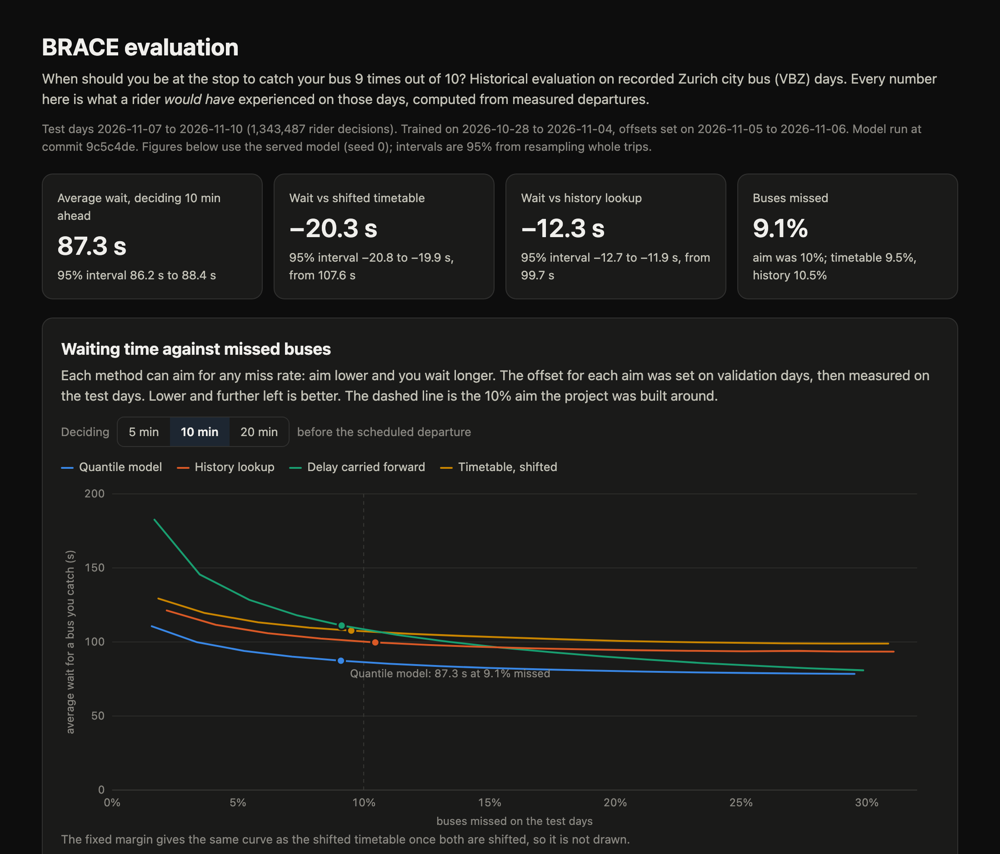

# BRACE

Bus Range And Calibration Engine. It tells you when to be at the bus stop so you catch the bus
9 times out of 10, and how long you'll usually wait.

The timetable says 17:12. The bus might leave at 17:11 or 17:19. BRACE learns from past departures
and from what the bus has done so far today, and answers "be there by 17:12:40".

[](https://itsmeck24.github.io/brace/dashboard/)

[Evaluation dashboard](https://itsmeck24.github.io/brace/dashboard/): tradeoff curves, breakdowns by
hour, line and how fresh the bus data was, and two replayed trips (one caught, one missed).

## Results

Historical evaluation on recorded Zurich city bus (VBZ) departures from Swiss open data, measured
to the second. Trained on 2026-10-28 to 11-04, "be there by" offsets set on 11-05 and 11-06, then
scored once on 4 frozen days (2026-11-07 to 11-10, Saturday to Tuesday, 1.34 million rider
decisions). Mean over the test days, ± the spread between days; the model row also averages 3 seeds.

| Method | Avg wait, deciding 5 / 10 / 20 min ahead | Buses missed (10 min ahead) |
| --- | --- | --- |
| Timetable, shifted to miss 10% | 107.6 / 107.6 / 107.6 s | 9.5% ± 1.3 |
| History by line, stop and hour | 99.7 / 99.7 / 99.7 s | 10.5% ± 2.0 |
| Current delay carried forward | 93.4 / 111.1 / 129.2 s | 9.1% ± 0.5 |
| **Quantile model** | **74.9 / 87.3 / 96.0 s** | **9.1% ± 0.3** |

- **20 seconds less waiting per trip, with fewer missed buses.** Deciding 10 minutes ahead the model
  waits 87.3 s against 107.6 s for the shifted timetable (19% less) and 99.7 s for the history
  lookup (12% less). 95% interval for the saving against the timetable: 19.9 to 20.8 s, from
  resampling whole trips.
- **Less waiting at every reliability level, not just at 10%.** Every method was also tuned to miss
  2%, 4%, ... 30% of buses. At each of those levels the model waits less than the timetable and
  the history lookup, on the test days and on the later day below.
- **It held on a day that did not exist when it was frozen.** On 2026-11-11, a worse day for delays
  (the shifted timetable waited 139.8 s), the model waited 113.4 s: 19% less than the timetable and
  13% less than history, missing 9.1% of buses.
- **The gain comes from live readings of the bus.** When the bus had left an earlier stop in the
  last 2 minutes, the model saved 25 s over history (33 s on 11-11). Before the bus had been seen
  at all, it saved 2 to 3 s. That is also why 20 minutes ahead, when most buses have not started
  yet, it is only 4% better than history.
- **9 in 10 overall, not on every line.** The offset is shared across lines, so the share of missed
  buses ranged from 4% to 16% between lines. Per-line offsets are the next step.

Raw numbers with the command, commit and package versions: `results/test_summary.csv`,
`results/test_run.json`, `results/analysis/` (curves, intervals, breakdowns) and
`results/forward_2026-11-11_2026-11-11_*`.

## How it works

```
daily source file ──> adapter ──> stop events (Parquet) ──> dbt: clean + tests ──> training rows
                                                                                     │
                       FastAPI /plan <── saved model <── fit on earlier days ────────┘
```

- **Adapters** turn each agency's data into one stop-event table. `brace/swiss.py` reads Swiss
  Ist-Daten. `brace/gtfs_rt.py` reads GTFS-Realtime (tried on Valley Metro in Phoenix), where
  arrivals have to be inferred as time windows and are labeled that way.
- **Training rows** are built in dbt: one row per departure and decision time (5, 10 or 20 minutes
  before), with features known at that moment only. Three dbt tests check that no feature uses
  anything that happened later.
- **Methods**: the timetable, a fixed margin, a history lookup by line, stop and hour, carrying the
  current delay forward, and a quantile gradient boosting model (scikit-learn). Each one's "be there
  by" offset is set on validation days, never on the days it is scored on.
- **API**: `/plan` returns "be there by", the likely departure and an 80% range, and on a recorded
  day also what actually happened.
- **Daily job**: an Airflow 3 DAG fetches yesterday's file, rebuilds and tests the tables, profiles
  the data and retrains on a rolling window. It has run end to end in Docker.

## Built to survive bad input

The ingest step is tested by breaking it on purpose (`tests/test_ingest_faults.py`, on a real
144-line excerpt of a source file):

| What goes wrong | What happens |
| --- | --- |
| A trip listed twice in the source | Exact copies are dropped before stops are numbered |
| The same day imported twice | One file, identical to a single import |
| Crash before the day is published | The previous file stays; nothing half-written is visible |
| A corrected file for a past day | `--replace` swaps in the whole day atomically |
| A column renamed in the source | Clear error, last good file kept |
| A day missing from a window | Training and evaluation stop and name the day |

A final test runs a duplicated import, a crash and a rerun, then builds the dbt tables and checks
they match a clean run row for row. Two builds of the full data give identical tables.

Checking that the evaluation reproduced turned up three data issues, all now fixed and tested:
whole trips listed twice in the source (0.04% of rows), stops in the same scheduled minute ordered
by chance, and a tie in the previous-bus feature. Re-running the frozen test on the fixed data
changed the model's 10-minute numbers by under 0.1 s and 0.01 points. The first run is kept in
`results/v1/`.

## Run it

Needs Python 3.13 and [uv](https://docs.astral.sh/uv/).

```
uv sync
uv run pytest -q                       # 27 tests, about a minute
```

Small version with no download, on the line 31 sample in `tests/fixtures`:

```
BRACE_DB=sample.duckdb uv run dbt build --project-dir dbt --profiles-dir dbt --vars '{events_glob: "tests/fixtures/events/*/*.parquet"}'
uv run python -m brace.evaluate --split dev --db sample.duckdb --out sample_results \
    --train-days 2026-10-28 2026-10-29 --val-days 2026-11-05 2026-11-05
```

Full pipeline on the days used here (downloads about 9 GB, keeps about 35 MB):

```
uv run python -m brace.swiss --start 2026-10-28 --end 2026-11-11 --operator VBZ
uv run dbt build --project-dir dbt --profiles-dir dbt --vars '{events_glob: "data/events/ch_vbz/*.parquet"}'
uv run python -m brace.evaluate --split test --save-predictions data/predictions
uv run python -m brace.evaluate --split forward --days 2026-11-11 2026-11-11 --save-predictions data/predictions
uv run python -m brace.analyze --label test
uv run python -m brace.analyze --label forward_2026-11-11_2026-11-11
uv run python -m brace.report --forward forward_2026-11-11_2026-11-11   # dashboard data
uv run python -m brace.train && uv run uvicorn brace.api:app
```

```
curl 'localhost:8000/plan?route=31&stop_id=853081211&sched_dep=2026-11-09T17:08&minutes_before=10'
```

With Docker: `docker build -t brace .` and run it with `data/` and `models/` mounted. The daily
Airflow job: `cd airflow && docker compose up -d --build` (UI on localhost:8080). It writes to its
own database and model, not the evaluated ones.

## Tests

| What | Real or mocked |
| --- | --- |
| Ingest failures and recovery | Real adapter and dbt on a real source excerpt; only the crash is forced |
| API end to end | Real dbt build and a real model on the line 31 sample, nothing mocked |
| GTFS-Realtime arrival labels | Real functions, hand-made vehicle reports |
| Calibration, scoring, history fallback | Real functions, small frames |
| dbt data tests | Run on the full data: unique and non-duplicated events, no future data in features |

CI runs the tests, the dbt build and a small evaluation on the sample, with no network.

## Data and licenses

- Code: MIT, see `LICENSE`.
- Zurich bus data: [opentransportdata.swiss](https://opentransportdata.swiss), Ist-Daten v2. Free
  to use and publish with the source cited ([terms](https://opentransportdata.swiss/en/terms-of-use/)).
  The files in `tests/fixtures` are small extracts of it.
- Phoenix data: Valley Metro GTFS-Realtime and GTFS from
  [Phoenix Open Data](https://phoenixopendata.com/dataset/general-transit-feed-specification)
  (CC BY / ODC-BY). Not included in this repo.
- This is an unofficial project, not endorsed by or affiliated with any transit agency or city.

